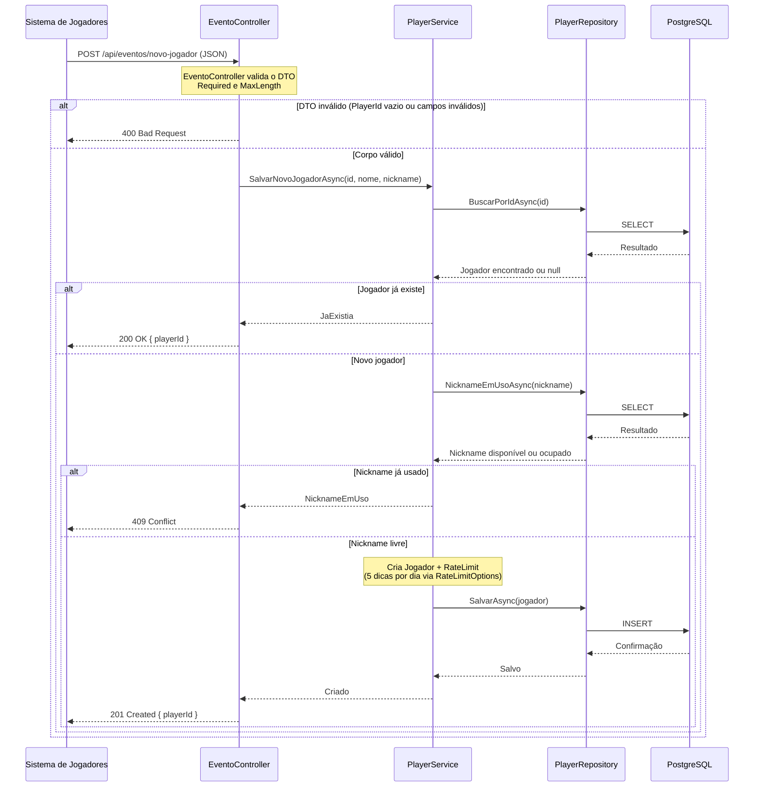
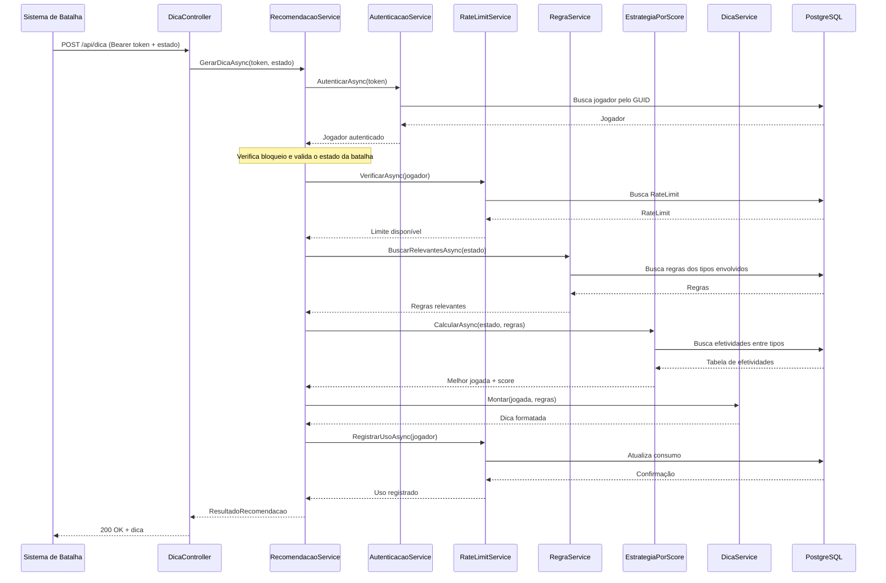
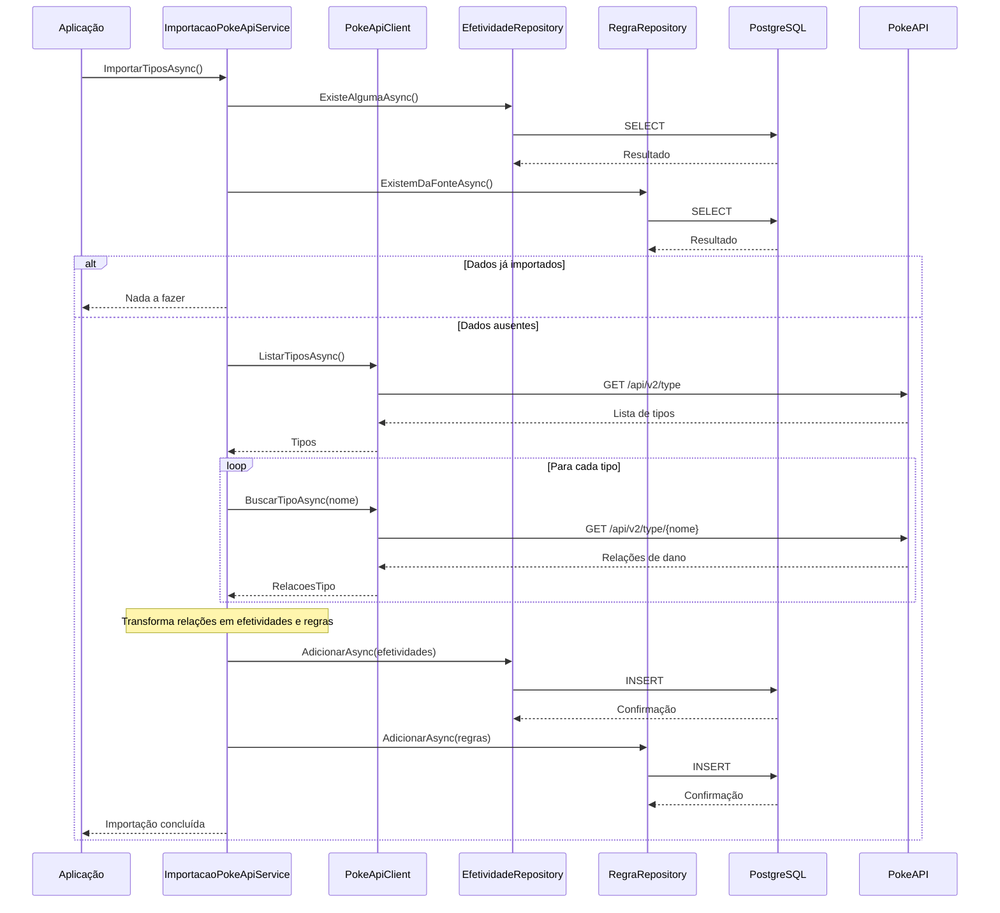

# Arquitetura e Padrões de Projeto

## Visão Geral

O serviço de **Recomendação de Cartas** auxilia o jogador durante uma partida, sugerindo a melhor jogada a partir do estado atual da batalha. O sistema considera as efetividades entre os tipos das cartas, calcula uma pontuação para cada jogada possível e retorna uma recomendação acompanhada de uma explicação.

Este documento descreve a arquitetura utilizada, os padrões de projeto aplicados, os princípios SOLID e os fluxos implementados no código.

Para deixar claro o andamento, cada item é identificado como **Implementado** (já existe no código) ou **Planejado** (ainda depende de desenvolvimento ou integração).

## Decisão Arquitetural: MVC

Avaliamos quatro padrões:

| Padrão | Ideia | No nosso projeto |
|---|---|---|
| **MVC** | Separa responsabilidades entre Model, View e Controller | Padrão principal da organização interna |
| **SPA** | Organiza uma interface web em uma única página | Não se aplica: o serviço não possui front-end |
| **MOM** | Integra aplicações por mensagens assíncronas | Evolução possível: receber eventos por um broker |
| **SOA** | Organiza serviços independentes com contratos | Descreve o ecossistema, não o desenho interno |

### Como o MVC aparece em uma API

| Parte | Pasta | Papel |
|---|---|---|
| **Controller** | `Controllers/` | Recebe e valida o DTO de entrada, chama o service e converte o resultado em resposta HTTP. Não decide regra de negócio. |
| **Model** | `Models/`, `Services/`, `Repositories/` | Entidades protegem o estado, services executam as regras do fluxo e repositories cuidam da persistência. |
| **View** | resposta JSON | Representação devolvida ao cliente, com o status HTTP (201, 200, 409 ou 400). |

### Por que MVC

- O Controller recebe a requisição sem concentrar regras de negócio.
- Services organizam as regras de cada etapa do fluxo.
- Repositories isolam o acesso ao PostgreSQL.
- A separação facilita testes e a aplicação dos princípios SOLID.
- O padrão combina com APIs desenvolvidas em ASP.NET Core.

## Estrutura de Pastas

```text
src/PokemonRecommender/
├── Controllers/
│   ├── DicaController.cs
│   └── EventoController.cs
├── DTOs/
│   ├── DicaDtos.cs
│   └── EventoDtos.cs
├── Data/
│   └── AppDbContext.cs
├── Integrations/
│   ├── IPokeApiClient.cs
│   └── PokeApiClient.cs
├── Migrations/
├── Models/
│   ├── Admin.cs
│   ├── BattleState.cs
│   ├── Carta.cs
│   ├── Dica.cs
│   ├── EfetividadeTipo.cs
│   ├── Jogador.cs
│   ├── RateLimit.cs
│   ├── RateLimitPolicy.cs
│   ├── Regra.cs
│   ├── RelacoesTipo.cs
│   └── Usuario.cs
├── Repositories/
│   ├── IPlayerRepository.cs
│   ├── PlayerRepository.cs
│   ├── IRateLimitRepository.cs
│   ├── RateLimitRepository.cs
│   ├── IRegraRepository.cs
│   ├── PgVectorRegraRepository.cs
│   ├── IEfetividadeRepository.cs
│   └── EfetividadeRepository.cs
├── Services/
│   ├── PlayerService.cs
│   ├── RecomendacaoService.cs
│   ├── AutenticacaoService.cs
│   ├── RateLimitService.cs
│   ├── RegraService.cs
│   ├── DicaService.cs
│   ├── EstrategiaJogada.cs
│   ├── EstrategiaPorScore.cs
│   ├── ImportacaoPokeApiService.cs
│   └── RateLimitOptions.cs
└── Program.cs
```

## Comunicação entre os serviços

O serviço possui três fluxos principais: cadastro de jogadores, solicitação de dicas e importação dos dados da PokeAPI.

### 1. Novo jogador (Sistema de Jogadores → Recomendação)

Comunicação **síncrona por HTTP**.

O Sistema de Jogadores envia um evento informando que um jogador foi cadastrado. A API recebe os dados, verifica se o jogador já existe e se o nickname está disponível. Caso esteja tudo certo, cria o jogador junto com seu limite inicial de dicas.



**Comportamentos importantes:**

- **Idempotência:** se o evento chegar novamente para um jogador já cadastrado, a API responde `200` sem criar outro registro.
- **Nickname único:** se o nickname já pertencer a outro jogador, a API responde `409`.
- **Rate Limit inicial:** cada novo jogador recebe um limite de 5 dicas por dia, configurado através de `RateLimitOptions`.
- **Separação de responsabilidades:** o Controller recebe a requisição, o Service executa as regras e o Repository realiza as operações no PostgreSQL.

Se futuramente a comunicação passar a utilizar um broker com filas, somente a porta de entrada será alterada: um consumidor da fila poderá chamar o mesmo `IPlayerService`, mantendo as regras de negócio e a persistência.

### 2. Pedir dica (Sistema de Batalha → Recomendação)

Comunicação **síncrona**, baseada em pedido e resposta HTTP.

O Sistema de Batalha envia o estado atual da partida e o token do jogador. A API autentica o jogador, verifica as condições para solicitar uma dica e calcula a melhor jogada.



**Etapas do fluxo:**

1. O `DicaController` recebe o JSON, extrai o token do cabeçalho Authorization e converte o DTO em `BattleState`.
2. O `RecomendacaoService` coordena o processo e chama o `AutenticacaoService` para identificar o jogador.
3. O serviço verifica se as dicas estão bloqueadas e valida o estado da partida.
4. O `RateLimitService` verifica se o jogador ainda possui dicas disponíveis.
5. O `RegraService` busca as regras correspondentes aos tipos das cartas presentes na partida.
6. A estratégia `EstrategiaPorScore` consulta as efetividades armazenadas no banco e calcula a melhor jogada.
7. O `DicaService` monta a recomendação e sua explicação.
8. O uso da dica é registrado no banco somente depois que a recomendação foi gerada.
9. O Controller retorna o resultado com o status HTTP correspondente.

**Cálculo da recomendação:**

A estratégia atual considera as cartas que o jogador possui no campo e na mão. Cada candidata recebe uma pontuação baseada na efetividade dos seus tipos contra os tipos da primeira carta do oponente em campo.

A carta com a maior pontuação é escolhida como recomendação.

O resultado contém a ação sugerida, o score esperado e uma explicação textual baseada nas regras relevantes.

**Respostas possíveis:**

| Status | Significado |
|---|---|
| `200 OK` | Dica gerada com sucesso. |
| `401 Unauthorized` | Jogador não autenticado. |
| `403 Forbidden` | Dicas bloqueadas para o jogador. |
| `422 Unprocessable Entity` | Estado da batalha inválido. |
| `429 Too Many Requests` | Limite de dicas atingido. |
| `503 Service Unavailable` | Dados necessários para a recomendação indisponíveis. |

**Observação sobre autenticação:** atualmente, o token é o próprio GUID do jogador. Essa implementação é provisória, enquanto o formato de autenticação é combinado com o Sistema de Jogadores. Ainda não existe integração com JWT nesse fluxo.

### 3. Importação da PokeAPI (Recomendação → PokeAPI)

Comunicação **síncrona por HTTP**, utilizando `HttpClient`.

Na inicialização em ambiente de desenvolvimento, o `ImportacaoPokeApiService` verifica se os dados necessários já existem no PostgreSQL. Caso estejam ausentes, consulta a PokeAPI e importa as relações de efetividade e as regras textuais.



**Etapas da importação:**

1. O serviço verifica se existem efetividades e regras da PokeAPI no banco.
2. Se necessário, consulta a lista de tipos através de `GET /api/v2/type`.
3. Para cada tipo, consulta suas relações através de `GET /api/v2/type/{nome}`.
4. As relações são transformadas em registros de efetividade, com multiplicadores de dano.
5. Também são geradas regras textuais que descrevem as relações entre os tipos.
6. Os dados são persistidos no PostgreSQL.

Após a importação, a recomendação utiliza os dados armazenados localmente, sem depender de novas chamadas à PokeAPI durante cada partida.

**Tratamento de falhas:** se a PokeAPI estiver indisponível durante a inicialização, a exceção é registrada no log e a aplicação continua em execução. Caso os dados de efetividade ainda não estejam disponíveis, uma solicitação de dica poderá retornar `503 Service Unavailable`.

A importação automática descrita acima está configurada para o ambiente de desenvolvimento no `Program.cs`.

## Padrões de Projeto

| Padrão | Onde | Estado |
|---|---|---|
| Repository | `Repositories/` | Implementado |
| Injeção de dependência | `Program.cs` e construtores | Implementado |
| DTO | `DTOs/` | Implementado |
| Options | `Services/RateLimitOptions.cs` | Implementado |
| Strategy | `EstrategiaJogada` e `EstrategiaPorScore` | Implementado |
| Adapter / cliente de integração | `Integrations/PokeApiClient.cs` | Implementado |
| Adapter para integração com outros grupos | Integrações externas | Planejado |

### 1. Repository (Implementado)

**Localização:** `Repositories/`

Abstrai o acesso aos dados. Os services conhecem as interfaces dos repositories, enquanto as implementações concretas utilizam o Entity Framework Core para acessar o PostgreSQL.

Exemplo:

```csharp
public interface IPlayerRepository
{
    Task<Jogador?> BuscarPorIdAsync(
        Guid id,
        CancellationToken ct = default);

    Task<bool> NicknameEmUsoAsync(
        string nickname,
        CancellationToken ct = default);

    Task SalvarAsync(
        Jogador jogador,
        CancellationToken ct = default);
}
```

**Benefícios:**

- Centraliza o acesso ao banco.
- Isola os services dos detalhes do Entity Framework.
- Facilita testes utilizando implementações falsas.
- Permite substituir a implementação de persistência sem alterar as regras de negócio.

### 2. Injeção de dependência (Implementado)

**Localização:** `Program.cs` e construtores.

As dependências são recebidas pelos construtores, preferencialmente através de interfaces. O `Program.cs` registra as associações entre as abstrações e suas implementações.

Exemplo:

```csharp
builder.Services.AddScoped<IPlayerRepository, PlayerRepository>();
builder.Services.AddScoped<IPlayerService, PlayerService>();

builder.Services.AddScoped<IRateLimitService, RateLimitService>();
builder.Services.AddScoped<IRecomendacaoService, RecomendacaoService>();
```

Exemplo de utilização:

```csharp
public class PlayerService(
    IPlayerRepository repository,
    IOptions<RateLimitOptions> options) : IPlayerService
```

**Benefícios:**

- Aplica a inversão de dependência (D do SOLID).
- Reduz o acoplamento entre classes.
- Facilita a substituição de implementações.
- Permite utilizar diferentes implementações em testes.

### 3. DTO (Implementado)

**Localização:** `DTOs/`

Os DTOs representam os dados recebidos e devolvidos pela API, mantendo o contrato HTTP separado das entidades utilizadas internamente.

Exemplo:

```csharp
public sealed record NovoJogadorEvento
{
    [Required]
    public Guid PlayerId { get; init; }

    [Required, MaxLength(100)]
    public string Nome { get; init; } = default!;

    [Required, MaxLength(50)]
    public string Nickname { get; init; } = default!;
}
```

O `[ApiController]` permite que as validações de Data Annotations sejam executadas automaticamente antes da chamada ao método do Controller. A verificação de `Guid.Empty` é feita explicitamente no `EventoController`.

**Benefícios:**

- Mantém o contrato da API separado das entidades.
- Valida os dados na entrada do sistema.
- Evita expor diretamente os modelos internos nas requisições.

### 4. Options (Implementado)

**Localização:** `Services/RateLimitOptions.cs`

O padrão Options permite configurar os valores utilizados pelo sistema sem deixá-los fixos nas regras de negócio.

Exemplo:

```csharp
public class RateLimitOptions
{
    public int LimiteInicial { get; set; } = 5;

    public TimeSpan Janela { get; set; } = TimeSpan.FromDays(1);
}
```

O `Program.cs` registra as configurações através de:

```csharp
builder.Services.Configure<RateLimitOptions>(
    builder.Configuration.GetSection("RateLimit"));
```

Os valores padrão são 5 dicas por dia.

**Benefícios:**

- Permite alterar o limite sem modificar a lógica do service.
- Facilita a configuração de diferentes ambientes.
- Mantém os parâmetros de rate limit centralizados.
- Segue a decisão documentada no ADR-0001.

### 5. Strategy (Implementado)

**Localização:** `Services/EstrategiaJogada.cs` e `Services/EstrategiaPorScore.cs`

O Strategy permite encapsular um algoritmo em uma implementação separada, facilitando sua substituição por outra estratégia sem concentrar toda a lógica no orquestrador.

Interface atual:

```csharp
public interface EstrategiaJogada
{
    Task<Jogada> CalcularAsync(
        BattleState estado,
        IReadOnlyList<Regra> regras,
        CancellationToken ct = default);
}
```

Implementação atual:

```csharp
public class EstrategiaPorScore : EstrategiaJogada
```

A `EstrategiaPorScore` calcula a pontuação das cartas disponíveis e retorna a jogada com maior efetividade contra o primeiro Pokémon do oponente em campo.

O `RecomendacaoService` utiliza a abstração `EstrategiaJogada`, sem precisar conhecer os detalhes internos do algoritmo.

**Benefícios:**

- Separa o algoritmo de recomendação do restante do fluxo.
- Permite adicionar novas estratégias.
- Facilita testar cada algoritmo separadamente.
- Aplica o princípio aberto/fechado (O do SOLID).

Atualmente existe uma implementação concreta: `EstrategiaPorScore`. Outras estratégias poderão ser adicionadas futuramente.

### 6. Adapter / Cliente de integração (Implementado parcialmente)

**Localização:** `Integrations/`

A integração com a PokeAPI utiliza uma interface para isolar as chamadas HTTP e transformar as respostas externas em objetos utilizados internamente.

Interface:

```csharp
public interface IPokeApiClient
{
    Task<IReadOnlyList<string>> ListarTiposAsync(
        CancellationToken ct = default);

    Task<RelacoesTipo> BuscarTipoAsync(
        string nome,
        CancellationToken ct = default);
}
```

Implementação:

```csharp
public class PokeApiClient(HttpClient http) : IPokeApiClient
```

O `PokeApiClient` encapsula as requisições HTTP e a desserialização dos dados recebidos da API externa.

**Benefícios:**

- Isola os detalhes de comunicação com a PokeAPI.
- Evita espalhar chamadas HTTP pelo restante do sistema.
- Permite substituir o cliente sem modificar o serviço de importação.

A integração com a PokeAPI já está implementada. A criação de adapters específicos para a comunicação com os outros grupos ainda está planejada, pois depende da definição dos contratos de integração.

## SOLID no código

| Princípio | Onde aparece |
|---|---|
| **S — Single Responsibility** | O Controller trata HTTP, o `PlayerService` executa as regras do cadastro e o `PlayerRepository` acessa os dados. |
| **O — Open/Closed** | A interface `EstrategiaJogada` permite adicionar novas estratégias sem modificar o fluxo principal de recomendação. |
| **L — Liskov Substitution** | `Jogador` e `Admin` herdam de `Usuario`, compartilhando sua estrutura básica de identificação. |
| **I — Interface Segregation** | As interfaces são separadas por responsabilidade, como `IPlayerRepository`, `IRateLimitRepository` e `IRegraRepository`. |
| **D — Dependency Inversion** | Os services utilizam abstrações para acessar repositories e outros componentes, com as implementações registradas no `Program.cs`. |

O projeto utiliza esses princípios para reduzir o acoplamento e facilitar a manutenção. Alguns pontos ainda podem evoluir conforme novas funcionalidades e integrações forem implementadas.

## Pontos Positivos

- **Separação de responsabilidades:** Controllers, Services e Repositories possuem papéis distintos.
- **Testabilidade:** o cadastro de jogadores possui uma coleção Postman executada pelo Newman, cobrindo os caminhos de sucesso, duplicidade e validações.
- **Configuração externa:** os parâmetros do rate limit são centralizados em `RateLimitOptions`.
- **Estratégia substituível:** o algoritmo de recomendação está isolado em uma implementação de Strategy.
- **Persistência organizada:** o Entity Framework Core e os repositories centralizam o acesso ao PostgreSQL.
- **Integração isolada:** a comunicação com a PokeAPI fica encapsulada em `PokeApiClient`.
- **Integração contínua:** o GitHub Actions executa build e testes de integração em pushes e pull requests.

## Limitações e Desafios

- **Autenticação provisória:** atualmente o token é o GUID do jogador. A integração com o mecanismo definitivo de autenticação depende dos contratos com o Sistema de Jogadores.
- **Rate Limit não atômico:** o service consulta o limite e registra o consumo em operações separadas. Requisições simultâneas podem ultrapassar o limite disponível. É necessário tornar a operação atômica no banco.
- **Concorrência no cadastro:** duas requisições simultâneas com o mesmo nickname podem passar pela verificação inicial. O índice único do PostgreSQL impede a duplicidade, mas a exceção de persistência ainda precisa ser tratada para retornar `409` em vez de um erro interno.
- **Resposta do cadastro:** o JSON de resposta é montado diretamente no Controller, sem um DTO específico de resposta.
- **Integração entre grupos:** os adapters e contratos definitivos de comunicação ainda dependem da definição das interfaces externas.
- **Busca vetorial:** o projeto possui suporte ao pgvector e campo de embedding, mas a busca por similaridade ainda não está implementada. Atualmente, as regras são recuperadas pelos tipos presentes na partida.

## Próximos Passos

1. Definir e implementar o mecanismo definitivo de autenticação com os outros grupos.
2. Tratar conflitos de unicidade durante o cadastro para retornar `409 Conflict` corretamente.
3. Definir os contratos de integração e implementar os adapters necessários para os outros serviços.
4. Avaliar a implementação de busca por similaridade utilizando pgvector e embeddings.
5. Avaliar a utilização de mensageria quando houver um broker definido.

## Documentos desta pasta

- [Diagrama de classes e SOLID](DiagramaClassesSOLID.svg)
- [Diagrama de casos de uso](Diagrama_casos_de_uso.jpg)
- [ADR-0001: limite de dicas](ADR-0001-limite-de-dicas-v1.pdf)

## Conclusão

A arquitetura organiza o serviço em camadas com responsabilidades bem definidas, utilizando MVC como referência e padrões como Repository, Strategy, DTO e Options para estruturar o código.

Os fluxos de cadastro de jogadores, recomendação de jogadas e importação dos dados da PokeAPI já possuem implementação. O sistema também conta com autenticação provisória, controle de consumo de dicas e cálculo de recomendações baseado nas efetividades entre os tipos de Pokémon.

A estrutura atual permite evoluir o projeto com novas estratégias, autenticação integrada, busca vetorial e comunicação com outros serviços, sem precisar concentrar essas mudanças nos Controllers ou modificar toda a lógica existente.